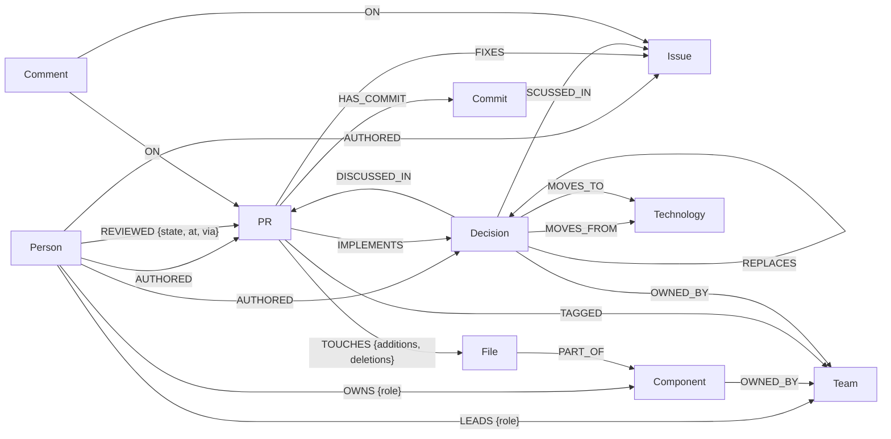

# Moolai: Execution Plan

> **Status:** plan approved. Done: scaffold (FalkorDB in Docker, schema, `/api/health`) and **KEP ingestion**
> (`python -m moolai.ingest.keps`: 645 decisions, 32 teams, ~700 people, tracking-issue stubs, REPLACES / SEE_ALSO,
> incremental via git sha in `SyncState`) and **GitHub ingestion, run live Oct 17**
> (`python -m moolai.ingest.pulls`, ~15 min first run, ~15 s incremental):
> 638 tracking issues · 1,371 k/k PRs (sig/auth, network, node since Apr 1) · 1,282 backfilled implementation PRs ·
> 5,953 reviews (Prow + GitHub) · 3,346 IMPLEMENTS · 709 FIXES · 9.5k files in 133 components · 61k comments ·
> 2,150 people. **Core queries done** (`moolai/brain.py`, `/api/experts|reviewers|onboarding|decisions`):
> reviewer suggestions hit a real reviewer in the top 3 for **79.1%** of 700 merged PRs (54.4% at #1), vs 63.7% /
> 30.3% for "the SIG's busiest reviewers" and 9.3% for a random past reviewer ([docs/backtest.md](docs/backtest.md)).
> **Agent built** (`POST /api/ask`): a graph-only keyword router (English + Tanglish) answers today. The Claude agent
> (`moolai/agent.py`, 6 tools over the same queries, grounding check) and the KEP X→Y extraction
> (`python -m moolai.extract`, 237 KEPs, Batches API) are tested with a fake client but **not run live yet: no
> `ANTHROPIC_API_KEY`**. **UI done** (`web/`): Ask, Reviewers, Onboarding, an evidence graph, the Cypher
> inspector and Sync now, checked in the browser in light, dark and phone layouts. Next: a live Claude run.
>
> **Hackathon:** Graph Hacks: Context for AI Agents (WeMakeDevs × FalkorDB)
> **Track:** 03, Company Brain
> **Hard deadline:** Oct 18, 11:59 PM **India time** (= 7:29 PM on this machine's UTC+1 clock).
> **Internal submit target:** Oct 18, 10:30 PM India time (6:00 PM UTC+1).

*Moolai* (மூளை) means "brain" in Tamil. Point it at a public GitHub org, and it builds that org's company brain
in FalkorDB. People, teams, PRs, issues, files, components and design decisions all go into one graph. An agent
answers "why did we switch?", "who knows this?" and "who should review this?" with a **graph path and a link for
every claim**.

---

## 0. Decisions to approve

| # | Decision | Proposal | Alternative if rejected |
|---|---|---|---|
| D0 | Entry | Track 03 only | Also tag Track 01 if the reviewer/onboarding actions feel strong enough. ⚠️ Why-Graph (`we-make-devs-hack`) also lists Track 03. If it's the same team, confirm that one team may submit two projects. The event page doesn't say. |
| D1 | "Company" | **Kubernetes**: `kubernetes/enhancements` (every KEP) plus `kubernetes/kubernetes` PRs labelled `sig/auth`, `sig/network` or `sig/node` from the last ~6 months, plus the older PRs that KEPs link to | **FastAPI org**: small and quick to ingest, but one maintainer dominates reviews (weak reviewer demo) and few decisions are written down. **LangChain**: many maintainers, but noisy and few written decisions. |
| D2 | Stack | Python 3.12 · FastAPI · uv · React + Vite + TS (copy the ninaivu `web/` shell: GraphView, QueryInspector) | n/a |
| D3 | Graph DB | FalkorDB in local Docker, `falkordb/falkordb:v4.22.1`, on host ports **6380 / 3001** because Why-Graph's container already uses 6379 / 3000 | FalkorDB Cloud if we deploy live |
| D4 | LLM | `claude-opus-5-5` everywhere. Effort `low` for routing, `medium` for answers. The Batches API (50% off) for bulk KEP extraction. | `claude-haiku-5-5` for the bulk extraction only (cheaper; team's call) |
| D5 | Retrieval | FalkorDB **full-text** indexes, no embeddings (one fewer API key, and KEP titles are keyword-heavy) | Voyage vectors on `Decision`/`PR` later (stretch) |
| D6 | Hosting | Local `docker compose` plus a demo video. The rules allow this: "complete local setup instructions and a working demo video". | Live VM + FalkorDB Cloud (stretch) |
| D7 | Repo | Local git now. A **public** GitHub repo `moolai` before submission. | n/a |

### Why Kubernetes is the right "company"

Kubernetes already writes down everything a company brain needs, in machine-readable form:

| Company concept | Kubernetes source | Format |
|---|---|---|
| Teams | SIGs (`sig/*` labels, `kubernetes/community/sigs.yaml`) | YAML + labels |
| RFCs / design decisions | **KEPs**: `keps/sig-*/NNNN-slug/kep.yaml` + `README.md` (Summary, Motivation, **Alternatives**) | YAML + Markdown |
| Decision ↔ discussion | KEP number = tracking issue number in `kubernetes/enhancements` | deterministic link |
| Decision history | `kep.yaml`: `status`, `stage`, `latest-milestone`, `replaces`, `see-also` | YAML |
| Formal ownership | `OWNERS` / `OWNERS_ALIASES` files (approvers, reviewers per directory) | YAML |
| Actual expertise | who authored and reviewed which files, and when | GitHub GraphQL |
| Reviews | GitHub reviews **plus Prow `/lgtm` and `/approve` comments** (most k8s reviews happen this way) | comments |

So "Why X → Y?" has a real, written answer (the KEP's Motivation and Alternatives). "Who owns auth?" has an
official answer (OWNERS) *and* an actual one (activity), and the difference between the two is itself an insight.

---

## 1. Pitch

"Kubernetes has 3,000+ contributors and hundreds of KEPs, and the *why* behind every design is spread across issues,
PRs and review threads. Moolai turns all of it into one graph. Ask why kube-proxy moved from iptables to nftables,
and you get the decision, the people, the discussion and the implementing PRs, each with a link. Ask who knows the
auth module, and you get people ranked by what they actually touched and reviewed. Open a PR, and it tells you who
should review it, with a measured hit rate."

## 2. Track 03 fit (judging map)

| Track 03 focus | Moolai implementation |
|---|---|
| Combining knowledge from docs, tickets and chats | KEP READMEs (docs), issues (tickets), PR and issue comment threads plus reviews (chats), all in one graph |
| Who owns and knows what | **Formal**: OWNERS files and SIG leads. **Actual**: recency-weighted authorship and reviews per file and component. **Drift**: where the two disagree. |
| Tracing decisions to their source | `Decision -[:DISCUSSED_IN]-> Issue`, `PR -[:IMPLEMENTS]-> Decision`, `REPLACES` chains, `MOVES_FROM` / `MOVES_TO` technology edges |
| Keeping knowledge current | Incremental sync: per-source watermarks stored **in the graph** (`SyncState`), `git diff` for KEPs, and a sync worker every 10 min |
| Answers with clear sources | Every answer carries evidence chips (node + URL) and the named Cypher that produced it. A grounding check strips any link that isn't in the evidence. |
| FalkorDB is central | Every answer, ranking and trace is a named Cypher query. **Graph-only mode** turns the LLM off and still returns the same experts, reviewers and decision trace. |

---

## 3. Architecture

```
 GitHub GraphQL ─┐                         ┌─────────── React UI (Ask · Reviewers · Onboarding · Graph)
 git clone       ├─► Ingesters ─► FalkorDB ◄┤                 │  /api/*
 (enhancements,  │   (idempotent   brain_kubernetes           ▼
  OWNERS,        │    MERGE upserts) ▲      └── FastAPI ─► Agent (claude-opus-5-5, tool runner)
  sigs.yaml)  ───┘                  │                      │  every tool = one named query in queries/
                                    │                      └─ graph-only router (no LLM) ─ same tools
                   sync worker ─────┘  watermarks in (:SyncState)
                   (every 10 min)
                   KEP extractor ─► Claude Batches ─► (Decision)-[:MOVES_FROM|MOVES_TO]->(Technology)
```

### Request flow for `POST /api/ask`
1. Route the question to an intent: `why_switch`, `decision`, `who_knows`, `reviewers`, `onboarding`, `search`.
   Graph-only mode uses a keyword router. Otherwise Claude picks tools with `tool_choice: auto`.
2. Resolve entities with full-text queries: topic → `Component` / `Team` / `Technology` / `Decision`, PR ref → `PR`.
3. Run the named queries. Each one logs `{name, ms, rows}` for the Query Inspector.
4. Claude writes the answer **from the tool results only**, in the question's language (Tanglish in, Tanglish out).
5. Grounding check: every URL or id in the answer must exist in the evidence set. Anything else is stripped and
   flagged.
6. Return `{answer_md, intent, evidence[], path{nodes, links}, queries[], usage}`.

---

## 4. Graph data model (graph `brain_kubernetes`; one graph per company)



### Nodes
| Label | Key | Properties |
|---|---|---|
| `Person` | `login` | `name`, `is_bot`, `url` (no emails, ever) |
| `Team` | `id` (`sig-auth`) | `name`, `kind` (`sig` / `wg`) |
| `Component` | `id` (`auth`, `kube-proxy`) | `name`, `aliases[]`, `paths[]` (from `config/components.yaml`) |
| `File` | `id` (`repo:path`) | `repo`, `path` |
| `PR` | `id` (`kubernetes/kubernetes#123`) | `repo`, `number`, `title`, `body` (trimmed), `state`, `created_at`, `merged_at`, `updated_at`, `additions`, `deletions`, `url` |
| `Issue` | `id` | `repo`, `number`, `title`, `body` (trimmed), `state`, `kind` (`bug`, `feature`, `kep-tracking`), timestamps, `url` |
| `Decision` | `id` (`KEP-3866`) | `kind` (`kep` / `pr`), `title`, `status`, `stage`, `latest_milestone`, `created`, `summary`, `motivation`, `alternatives` (trimmed sections), `url`, `source_sha` |
| `Technology` | `name` | `aliases[]` (from the LLM extraction, e.g. `iptables`, `nftables`, `dockershim`) |
| `Commit` | `sha` | `headline`, `committed_at`, `url` |
| `Comment` | `id` | `body` (trimmed, bots dropped), `created_at`, `url` |
| `Repo` | `id` | `org`, `name` |
| `SyncState` | `source` | `cursor`, `last_run_at`, `stats` (JSON string) |

Timestamps are epoch seconds (ints), so windows, decay and "as of" time travel stay simple.

### Relationships (required by the brief, plus what we need)
```
(Person)-[:AUTHORED]->(PR|Issue|Commit|Decision|Comment)
(Person)-[:REVIEWED {state, at, via:'github'|'prow'}]->(PR)
(PR)-[:FIXES]->(Issue)                       closingIssuesReferences only (a "#N" regex can't tell issues from PRs)
(PR)-[:TOUCHES {additions, deletions}]->(File)-[:PART_OF]->(Component)-[:OWNED_BY]->(Team)
(Decision)-[:DISCUSSED_IN]->(Issue|PR)       tracking issue (same number) + KEP PRs in enhancements
(PR)-[:IMPLEMENTS]->(Decision)               "KEP-NNNN" / enhancements#NNNN in the PR body, links in tracking-issue comments
(Decision)-[:OWNED_BY]->(Team)  (Decision)-[:INVOLVES]->(Team)      owning-sig / participating-sigs
(Person)-[:REVIEWER_OF]->(Decision)  (Person)-[:APPROVER_OF {kind:'sig'|'prr'}]->(Decision)   kep.yaml + prod-readiness/
(Decision)-[:REPLACES]->(Decision)           kep.yaml replaces / superseded-by; a moved KEP replaces its old dir (KEP-N@old-sig)
(Decision)-[:SEE_ALSO]->(Decision)           kep.yaml see-also
(Decision)-[:MOVES_FROM|MOVES_TO]->(Technology)                     LLM-extracted, cached, validated
(PR|Issue)-[:TAGGED]->(Team)                 sig/* labels
(Person)-[:OWNS {role:'approver'|'reviewer'}]->(Component)          OWNERS files (should-have)
(Person)-[:LEADS {role:'chair'|'tech_lead'}]->(Team)                sigs.yaml (should-have)
(Comment)-[:ON]->(PR|Issue)                  human comments only, trimmed
(PR)-[:HAS_COMMIT]->(Commit), (PR|Issue)-[:IN_REPO]->(Repo)          not built yet (repo is a property)
```

### Indexes (`queries/00_schema.cypher`, already in the scaffold)
Range indexes on every key. Full-text indexes on `Decision(title, summary)`, `PR(title)`, `Issue(title)`,
`Technology(name)`, `Component(name)` and `Person(login, name)`.

---

## 5. Data and ingestion

The company is defined in [`config/sources.yaml`](config/sources.yaml). Component paths live in
[`config/components.yaml`](config/components.yaml), a draft to verify against the repo tree in hour 1.

| Source | How | Size (estimate, verify in hour 1) |
|---|---|---|
| All KEPs | `git clone --depth 1 kubernetes/enhancements`, then parse `kep.yaml` + README sections locally (no API cost) | several hundred KEP dirs |
| KEP tracking issues + comments | GraphQL; the issue number equals the KEP number | same count |
| KEP PRs in `enhancements` (design review threads) | GraphQL, PRs touching `keps/` | 1–2k |
| `kubernetes/kubernetes` PRs | GraphQL `search`, `label:sig/auth\|network\|node`, merged + open, split into month windows (search caps at 1,000 results per query) | 1–3k |
| KEP-linked k/k PRs (any age) | PR links parsed from tracking issues and KEP "Implementation History" | a few hundred |
| OWNERS / OWNERS_ALIASES | GraphQL `object(expression: "master:<dir>/OWNERS")` for component dirs | dozens |
| `kubernetes/community/sigs.yaml` | one file | 1 |

Ingestion rules:
- **Raw cache first.** Every GraphQL page is written to `data/raw/*.jsonl.gz` before loading, so reloads don't
  re-fetch. The same cache ships as a release asset, and `--offline` rebuilds the graph without a token.
- **Idempotent upserts.** `UNWIND $rows AS r MERGE (n:Label {key: r.key}) SET n += r.props`. On re-sync, a PR's
  `TOUCHES` / `REVIEWED` / `FIXES` edges are replaced, so edits show up.
- **Prow reviews.** Comment lines that start with `/lgtm` or `/approve` (not `... cancel`), from a non-bot who
  isn't the PR author, count as reviews. They're merged with GitHub reviews into **one** `REVIEWED {state, at, via}`
  edge per person and PR, keeping the strongest state (`APPROVED > LGTM > CHANGES_REQUESTED > COMMENTED`).
  `via` is `github`, `prow` or `both`.
- **Implementation links.** `(PR)-[:IMPLEMENTS {via}]->(Decision)` comes from KEP references in the PR title/body
  (`via:'pr_body'`) and from k/k PR links in human comments on the KEP's tracking issue (`via:'tracking_issue'`).
  Linked PRs that aren't fetched yet are stubs (`fetched = false`) until the backfill step.
- **Offline rebuild.** `python -m moolai.ingest.pulls --offline` replays every cached response (newest version of
  each item wins), so a graph can be rebuilt from `data/raw/github` without a token.
- **Noise filters:** bots (GitHub `Bot` actors, `k8s-ci-robot`, `k8s-triage-robot`, `*[bot]` matched literally)
  get `is_bot = true` and are excluded from rankings; their comments aren't stored. Skip `vendor/`, `zz_generated*`, `*.pb.go` and `api/openapi-spec/`. Cap files per PR at 300.
- **Rate limits:** read `rateLimit { cost remaining resetAt }` on every query. Use 25–50 PRs per page, and retry
  with a smaller page on 502s.
- **Never write to Kubernetes repos.** Moolai is read-only against upstream.

### KEP decision extraction (LLM, cached)
For KEPs in the three SIGs, send Summary + Motivation + Alternatives (trimmed) to `claude-opus-5-5` through the
**Batches API** with structured output (`client.messages.parse()` schema):
`{summary, moves_from[], moves_to[], rationale[], alternatives[{option, why_rejected}]}`.
Results are cached in `data/extract/KEP-NNNN.json`, keyed by the README sha, and validated with Pydantic before
writing `Technology` edges. Rough cost: ~250 KEPs × ~3k input tokens ≈ $3 input + $3 output, halved by batching.
**Graph-only mode doesn't need it:** without it, "why X → Y" falls back to full-text over decision titles and
summaries.

### Incremental sync (keeping knowledge current)
- `(:SyncState {source:'github:kubernetes/kubernetes:prs', cursor})`. Each run searches `updated:>=cursor`, upserts,
  then moves the cursor to the max `updatedAt` seen.
- KEPs: `git fetch`, then `git diff --name-only <last_sha>..origin/master -- keps/`, and re-parse only the changed KEP
  dirs (`last_sha` lives in `SyncState`).
- `sync` service in docker compose: `python -m moolai.sync --loop 600`. The UI shows "synced 4 min ago · +3 PRs, +11
  reviews" and a **Sync now** button.
- Stretch: GitHub webhook to `/api/webhooks/github` through smee.io.

---

## 6. Named queries (`queries/*.cypher`)

The code runs each query by name, and the README links to the same files, so judges read exactly what runs.

| Query | Answers |
|---|---|
| `00_schema` | indexes ✅ |
| `upsert_*`, `link_*`, `sync_state_get/set` | ingestion writes (KEP ones ✅) |
| `resolve_topic` | "auth module" → Component / Team / Technology / Decision (full-text + aliases) |
| `decision_find` | full-text over decisions |
| `decision_switch` | **"Why X → Y?"**: decisions with `MOVES_FROM` X and `MOVES_TO` Y |
| `decision_trace` | decision → discussion, implementing PRs, people, replaced decisions, with URLs ✅ |
| `who_knows` | ranked experts for a component or team, with reasons |
| `formal_owners` | OWNERS approvers / reviewers and SIG leads for a component |
| `ownership_drift` | formal owners who've gone quiet, and active experts who aren't owners (should-have) |
| `pr_context` | files → components → teams for a PR |
| `suggest_reviewers` | top-k reviewers for a PR, with `$as_of` time travel for the backtest |
| `onboarding_*` | key people, hot files, decisions in flight, recent PRs, open good-first-issues for a component |
| `node_neighborhood` | graph view around any node |
| `sync_status` | last sync per source |

Sketches (final versions get tested on the smoke graph):

```cypher
// suggest_reviewers: people who recently authored or reviewed PRs in the same components.
// $as_of lets the backtest ask "what would we have suggested when this PR was opened?"
MATCH (target:PR {id: $pr_id})-[:TOUCHES]->(:File)-[:PART_OF]->(c:Component)
WITH target, collect(DISTINCT c) AS comps
UNWIND comps AS c
MATCH (c)<-[:PART_OF]-(:File)<-[:TOUCHES]-(q:PR)
WHERE q <> target AND q.merged_at < $as_of AND q.merged_at > $as_of - $window_s
WITH target, collect(DISTINCT q) AS prior
UNWIND prior AS q
MATCH (p:Person)-[r:AUTHORED|REVIEWED]->(q)
WHERE NOT p.is_bot AND NOT (p)-[:AUTHORED]->(target)
WITH p, q, max(CASE type(r) WHEN 'REVIEWED' THEN 1.0 ELSE 0.7 END) AS w
WITH p, sum(w * exp(-(($as_of - q.merged_at) / 86400.0) / 120.0)) AS score, count(q) AS prs
RETURN p.login AS login, score, prs
ORDER BY score DESC LIMIT $k
```

The real `decision_trace` is in [queries/decision_trace.cypher](queries/decision_trace.cypher). It returns the
decision plus lists (discussion, implementing PRs, authors, reviewers, approvers, replaces, see-also), with no
cartesian blow-up.

> **FalkorDB v4.22.1 gotcha:** if several pattern comprehensions in one `RETURN` reuse a variable name (e.g. `p`
> in two of them), only the first one returns rows. Give each comprehension its own variable names. A test in
> `tests/test_keps.py` guards this.

### Scoring (who knows / who reviews), as built

Both live in `queries/` with the formula in the file header.

- **Per earlier merged PR q:** `role · 2^(−age_days/90) / √(components q spans)`. Role is approve/lgtm 1.0,
  authored 0.7, other review 0.6. Dividing by the component span keeps dependency bumps and lint sweeps from
  counting as expertise.
- **`who_knows`:** sum over PRs touching the component in the last 365 days, plus `2·ln(1 + KEPs)` the person
  authored or approved, counting only KEPs owned by the component's team and implemented in it.
- **`suggest_reviewers`:** the same per-PR term times a match factor: same file 1.0, same directory 0.5, same
  component 0.25. Each component's scores become **shares**, weighted by the fraction of the PR's files in that
  component, so a busy component like kubelet can't drown out the one the PR is about. Only PRs merged before
  `$as_of` count (the PR's creation time). The author and bots are excluded. If file history runs out, the list is
  topped up with the SIG's busiest reviewers.
- **Backtest** (`python -m scripts.backtest_reviewers`, results in [docs/backtest.md](docs/backtest.md)): 700
  merged PRs; per-component normalization beat raw sums (53.6% vs 50.1% hit@1).
- **Repo-wide files** (`go.mod`, `go.sum`, `LICENSES/`) are skip rules: every dependency bump touches them.
  `python -m moolai.ingest.pulls --only prune` re-applies the skip rules to the existing graph.

---

## 7. Agent and tools

| Tool (one named query each) | Used for |
|---|---|
| `search(text)` | anything |
| `resolve_topic(text)` | "auth module" → component id |
| `decision_switch(x, y)` / `decision_trace(id)` | "Ean X-la irundhu Y-ku switch pannanga?" |
| `who_knows(component \| team)` + `formal_owners` | "Auth module pathi yaarukku theriyum?" |
| `suggest_reviewers(pr)` + `pr_context(pr)` | "Indha PR-ku yaar review pannanum?" |
| `onboarding(component)` | onboarding brief (Markdown, downloadable) |

LLM integration rules (same as ninaivu):
- Anthropic Python SDK, `client.beta.messages.tool_runner` with `@beta_tool`. Model `claude-opus-5-5`, adaptive
  thinking (the default), with `output_config.effort` set explicitly (the default is `medium`).
- `tool_choice` stays `auto`, because Opus 5.5 rejects forced tool use. Use structured outputs for extraction.
- Server-side refusal fallback on every call: `betas: ["server-side-fallback-2026-07-01"]`, `fallbacks: "default"`.
  Check `stop_reason == "refusal"`.
- The system prompt and tool definitions stay byte-stable for prompt caching. The question and the evidence go in
  the user turn.
- Cost ledger (`usage.jsonl`), as in ninaivu.

---

## 8. API contract (FastAPI, all under `/api`)

| Method | Path | Returns |
|---|---|---|
| GET | `/health` | `{ok, falkordb, graph, counts}` ✅ |
| GET | `/cypher?name=` | the source of a named query (Query Inspector) ✅ |
| POST | `/ask` | `{question, graph_only?}` → `{answer_md, intent, evidence[], path, queries[], usage}` |
| GET | `/experts?topic=` | `[{login, score, reasons[], formal_owner}]` |
| GET | `/reviewers?pr=kubernetes/kubernetes#123` | `{pr_context, suggestions:[{login, score, reasons[]}]}` |
| GET | `/onboarding?component=` | `{brief_md, sections}` |
| GET | `/decisions/{id}/trace` | `decision_trace` rows |
| GET | `/graph?id=&depth=` | `{nodes, links}` |
| POST | `/sync` · GET `/sync/status` | trigger a sync / last sync per source |

## 9. UI (React + Vite + TS, shell copied from ninaivu)

1. **Ask:** chat. Each answer shows source chips, a **Show path** button that highlights the subgraph, the Query
   Inspector, and a **Graph-only** toggle.
2. **Reviewers:** paste a PR URL to get the top 3 with reasons ("reviewed 9 PRs in `pkg/proxy/nftables` in the last 6
   months · OWNERS approver"), plus a backtest badge.
3. **Onboarding:** pick a component or SIG to get the brief, with a **Download .md** button.
4. **Top bar:** sync badge plus **Sync now**.

---

## 10. Timeline

It is about **24 hours to the deadline** (written Oct 17, ~11:40 PM India time).

| India time (event clock) | UTC+1 (this machine) | Block | Done when |
|---|---|---|---|
| Oct 17, 23:45 – 01:00 | 19:15 – 20:30 | **Setup:** GitHub token, public repo, team registration, Anthropic key; clone `enhancements`; KEP parser + loader | `MATCH (d:Decision) RETURN count(d)` is right; KEP-3866 has its SIG, authors, approvers and tracking issue |
| 01:00 – 04:00 | 20:30 – 23:30 | **GitHub ingester:** tracking issues, k/k PRs (3 SIGs), raw cache, Prow `/lgtm`, `FIXES` / `TOUCHES` / `IMPLEMENTS` | sanity queries pass (counts; KEP-3866 has implementing PRs) |
| 04:00 – 06:00 | 23:30 – 01:30 | **Core queries:** `who_knows`, `suggest_reviewers` + backtest, `decision_trace`, onboarding facts | backtest prints hit@3; `pytest` green |
| 06:00 – 11:30 | 01:30 – 07:00 | **Sleep** | n/a |
| 11:30 – 15:00 | 07:00 – 10:30 | **Agent:** `/api/ask`, graph-only router, grounding check; KEP extraction batch; onboarding brief; incremental sync + worker | the 3 demo questions answer correctly from a CLI script |
| 15:00 – 19:00 | 10:30 – 14:30 | **UI:** Ask, Reviewers, Onboarding, Graph view, sync badge | full demo works locally |
| **19:00** | **14:30** | **Feature freeze** | n/a |
| 19:00 – 22:00 | 14:30 – 17:30 | README (schema diagram, query catalog, setup, AI disclosure), snapshot release asset, demo video | all submission items ready |
| 22:00 – 22:30 | 17:30 – 18:00 | **Submit** | ✅ |
| 22:30 – 23:59 | 18:00 – 19:29 | Buffer | n/a |

## 11. Team split (up to 4)

| Owner | Area |
|---|---|
| **A, Graph + ingest** | `moolai/ingest/` (KEPs, GitHub GraphQL, OWNERS), schema, sync worker, raw cache / snapshot. Main speaker on the data model. |
| **B, Queries + agent** | `queries/`, scoring, backtest, `/api/ask`, KEP extraction, onboarding brief |
| **C, UI + demo** | `web/`, graph view, demo script, video |
| **D, Story + QA** (optional) | check the demo KEPs and their links, README, rehearsals, blog |

With 2 people: A+D and B+C. Solo: follow the timeline top to bottom and use the cut list early.
**Contract:** query names (§6) and the API contract (§8) are frozen in the first hour, so everyone can work against
stubs.

## 12. Demo video (~3 min)

Demo decisions to verify in hour 1 (candidates): **KEP-3866** nftables kube-proxy (iptables → nftables),
**KEP-2221** dockershim removal, **KEP-2579** Pod Security Admission (replaces PodSecurityPolicy), **KEP-2254**
cgroup v2, **KEP-3331** structured authentication config, **KEP-752** EndpointSlices.

1. **0:00–0:20** The problem: thousands of contributors, hundreds of KEPs. Who knows auth? Why nftables?
2. **0:20–0:40** Ingest stats, the schema, and the graph around KEP-3866.
3. **0:40–1:15** "Why did kube-proxy move from iptables to nftables?" The decision trace with links, the Query
   Inspector, then the Graph-only toggle gives the same trace.
4. **1:15–1:45** "Auth module pathi yaarukku theriyum?" (asked in Tanglish, answered in Tanglish). Ranked experts
   with reasons, next to the formal OWNERS: "OWNERS lists A, but B did 60% of the reviews this year."
5. **1:45–2:20** **Sync now** brings in PRs opened today. "Who should review this one?" gives the top 3 with reasons.
   Then the backtest card: hit@3 = X% vs Y% for a random OWNERS reviewer.
6. **2:20–2:45** Onboarding brief for kube-proxy, downloaded as Markdown.
7. **2:45–3:00** Architecture: every answer is a named Cypher query, and the graph is the product.

## 13. Submission checklist

- [ ] Public source repository
- [ ] README: pitch, architecture, **Mermaid data model**, query catalog in plain English, setup
      (`docker compose up` + ingest or `--offline` snapshot), track named (**Track 03, Company Brain**)
- [ ] Demo video, plus the live URL *or* complete local setup instructions
- [ ] AI usage disclosure: coding assistants used, and we can explain everything ("you must be able to explain what
      was built and why")
- [ ] Data note: public GitHub data from the Kubernetes project, read-only, logins only (no emails); KEPs are
      Apache-2.0
- [ ] "New work" statement: all Moolai and FalkorDB work was written during the event. Shared scaffolding copied from
      our ninaivu project (also written this week) is called out.
- [ ] Walkthrough so every member can explain the schema, the queries and the scoring
- [ ] Optional: blog post (side prize)

## 14. Risks and cut list

**Cut in this order if behind at Oct 18, 15:00 India time:**
1. LLM KEP extraction (`Technology` edges) → full-text "X → Y" over decision titles and summaries
2. OWNERS / sigs.yaml formal ownership and drift
3. Custom graph view → screen-record FalkorDB Browser (http://localhost:3001)
4. Live deployment (local + video is allowed)

**Never cut:** decision trace with links, `who_knows`, `suggest_reviewers` + the backtest number, onboarding brief,
incremental sync.

| Risk | Mitigation |
|---|---|
| A PR touches >100 files | GraphQL returns the first 100 per PR; `files_total` records the real count |
| Old PRs (2016) have an `lgtm` label but no `/lgtm` comment, so no reviewer | Known gap (17 merged PRs); far outside any scoring window |
| `kubernetes/kubernetes#N` links in tracking issues can be issues | Backfill deletes stubs GitHub says aren't PRs |
| PRs that touch many components (dependency bumps, lint sweeps) inflate expertise | Down-weight by number of components touched in the scoring (§6) |
| GitHub API timeouts or limits | Small pages, retries, raw cache on disk; ingest the 3 SIGs first, widen later |
| Most k8s reviews are Prow `/lgtm`, not GitHub reviews | Parse comments (§5) |
| Huge vendor/codegen PRs skew the graph | path filters + file cap |
| Bots dominate rankings | `is_bot` and an explicit bot list |
| Legacy KEP layouts with no `kep.yaml` | skip them and log the count |
| LLM extraction is wrong | Pydantic validation, cache, and graph-only fallback doesn't depend on it |
| FalkorDB query timeout on heavy aggregations | The image default is 1 s. Compose raises it to 10 s (`FALKORDB_ARGS`). If that's still too slow, pre-compute the `TOUCHES_COMPONENT` / `CO_REVIEWS` aggregates at ingest. |
| Port clash with Why-Graph / ninaivu | Moolai uses 6380, 3001 and 8020 |
| "Is public data OK?" | The event page doesn't restrict data sources. We store only public logins, never emails, and never write upstream. |

## 15. Stretch goals (only if time allows)

- **MCP server** (`who_knows`, `suggest_reviewers_for_paths`, `why`) so Claude Code inside a k8s checkout can ask
  "who should review my diff?"
- **Second company:** ingest the FastAPI org into `brain_fastapi` with the same code, to show the design isn't
  k8s-specific.
- **Informal teams:** `algo.labelPropagation` over a co-review graph, compared with the formal SIGs.
- Voyage embeddings for semantic search; a GitHub webhook for real-time sync.
